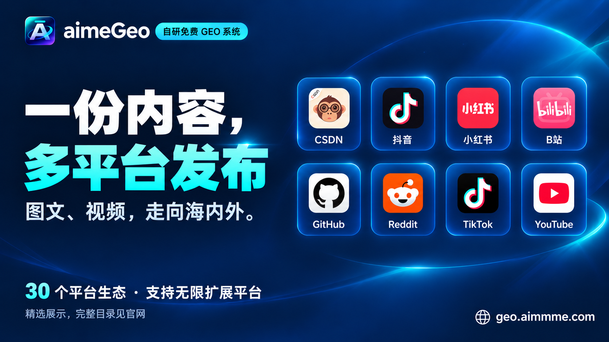

# 功能展示 / Feature gallery

## 和 AI 对话，让 GEO 跑起来 / Conversational GEO

## 一份内容，多平台发布 / Multi-platform publishing

## 多账号，各有独立环境 / Independent account environments

[产品官网](https://geo.aimmme.com/) · [功能展示](https://geo.aimmme.com/promotion/) · [平台与工具](platforms-and-models.md) · [工作界面](screenshot-index.md)

## 内容制作 / Content creation

## 引用观测 / Citation observations

## 封面与正文插图 / Covers and illustrations

以上为公开产品宣传示意，未展示真实账号、客户资料或私有服务地址。目录展示不等于每种工具均有已配置执行器。另见[推广文章与文案](promotion/README.md)。
