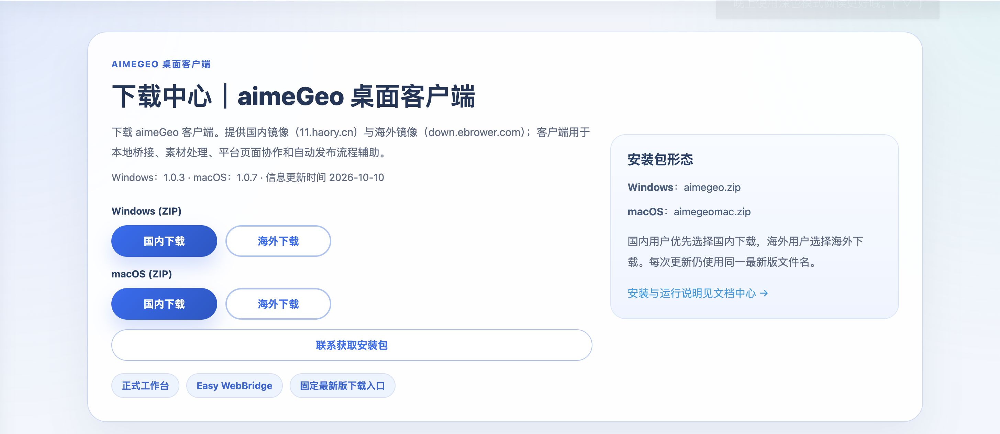
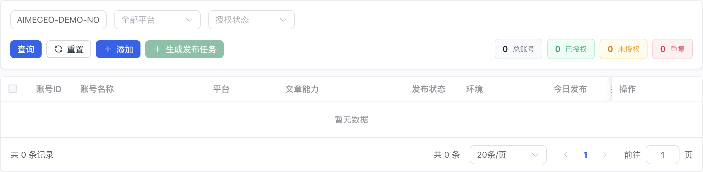
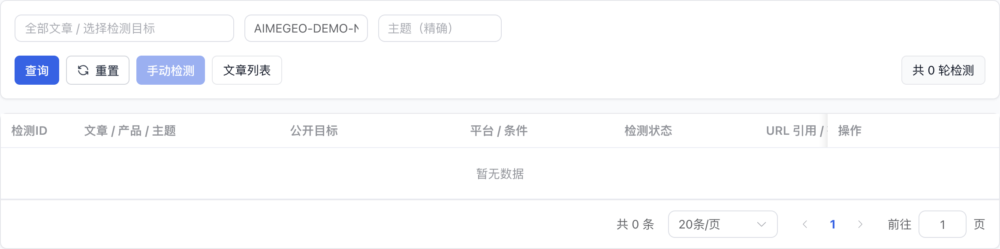

# aimeGeo 基础界面截图

以下为 2026-10-17 的真实产品网页预览截图，只展示产品介绍、公开下载页和四个基础列表。列表通过正式查询筛成空结果，再裁切到内容区；图中的零统计仅表示当前筛选结果，不是产品业务总量。图片没有真实稿件、账号或环境标识，也未执行保存、同步、发布或检测。

## 产品介绍

介绍“制作内容 → 自动发布 → 检测引用”的整体路径，并说明 EasyBR 浏览器协作。宣传清单与实际可用能力的差别见[平台与模型说明](platforms-and-models.md)。

## 官方下载中心

按系统选择国内或海外镜像。页面版本信息是截图当时的展示，下载时应重新打开[官方页面](https://geo.aimmme.com/download/)，不要仅依据截图里的旧版本号。

## 文章列表

查看文章标题、类型、分类、配图和操作入口。首次使用从“添加文章”开始，具体步骤见[新手指南](getting-started.md)。

## 账号授权列表

了解平台、账号身份、浏览器环境与连接操作的位置。实际操作使用本人已登录的目标浏览器，检查账号身份后再继续。

## 发布任务列表

查看任务来源、目标账号、内容类型、状态与操作入口；这张图只展示界面，不表示任何平台已实发成功。

## AI 引用监测列表

按产品或项目定位检测对象，查看引用任务、问题和检测记录入口。AI 同题复测在引用检测记录中进行；百度/必应搜索收录是另一项监测。

真实业务操作请按[使用流程](workflow.md)执行。界面随版本更新，截图用于认识字段与入口，不代替当前安装版本的实际结果。
